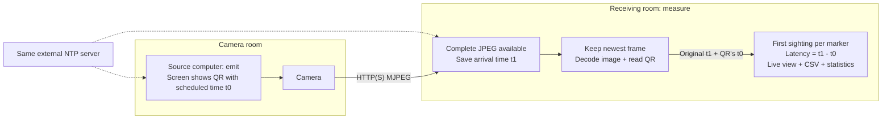

# Camera stream latency

**Disclaimer: AI-generated code.**



## Install on both computers

Requires Python 3.11+ and a Linux desktop.

```bash
python3 -m venv .venv
source .venv/bin/activate
pip install -e '.[test]'
```

## Configure the receiver

Edit `.env` (copy `.env.example` if needed):

```dotenv
CAMERA_URL='https://CAMERA_HOST/stream.mjpg'
CAMERA_USERNAME='viewer'
CAMERA_PASSWORD='your-password'
```

Use a multipart MJPEG endpoint with per-frame `Content-Length`.
`.env` stays out of Git. Run from its directory; CLI options override configuration.

## Run

**Check synchronization first:** `chronyc sources -v` and `chronyc tracking` on both
computers. Verify the selected server and small offsets.

In the camera room, point the camera at the source screen:

```bash
python -m camera_latency emit --interval-ms 200 --visible-ms 150
```

In the receiving room:

```bash
python -m camera_latency measure --output measurements.csv
```

Escape exits and prints statistics. Use fresh output filenames.

## Read the results

Recognition time doesn't inflate `arrival_latency_ms`. To examine scheduling
offsets, copy `source-timing.csv` to the receiver and join:

```bash
python -m camera_latency report --measurements measurements.csv \
  --source-log source-timing.csv --output joined.csv
```

Clock offsets, screen refresh, pixel response, exposure and missed detections limit
accuracy. Nanosecond units aren't nanosecond accuracy. Increase visibility if needed.
Delivered fps may vary; browser players may buffer further. Clock jumps are flagged;
negative values stay. Source logs capture submission, not physical pixel visibility.

Tests: `python -m pytest -q`. More options: `python -m camera_latency measure --help`.
